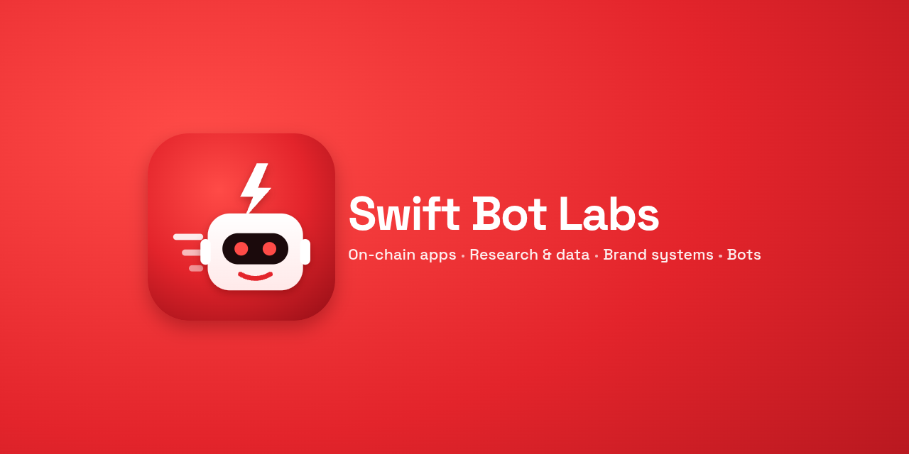

### Swift Bot Labs

A small product studio that ships working things: **on-chain payment apps**, **research and data reports**,
**brand systems** and **bots**. Live on mainnet where it matters, every number sourced, every demo reproducible.

#### Recent work

| Project | What it is |
|---|---|
| HSK Meter | Per-request API payments between agents on HashKey Chain **mainnet**: x402 v2, USDC.e settlement, automatic on-chain refunds, agent-to-agent resale. |
| Sauti Pesa | Offline Swahili + English voice wallet for USDT: on-device speech and intent, offline signing, scam checks. |
| Perps Copilot | Telegram trading copilot for a perps DEX on Somnia: orders, TP/SL, liquidation alerts, PnL cards. |
| USDC Meter · Demo-first Escrow · Pay-per-request | Payment primitives on Arc: prepaid metering with signed vouchers, escrow released on a working demo, an HTTP 402 paywall. |
| Holler logo system | Full brand system: neon-edged wordmark, app mark, favicon cut, one-ink and reversed variants, usage note. |
| Receipt-style explorer | Concept redesign of a block-explorer transaction page as a receipt that reconciles to the lamport. |

#### Research and data

- The worst tech prediction of 2016: traced to the original 2016 video and checked against 2025 data.
- A fake fact the internet believes: refuted with the company's own 1999 website, via the Wayback Machine.
- The most useful free API nobody knows about: Europe's power grid as keyless JSON, with a runnable demo.
- Protocol feedback reports: reproducible bugs with one-command repro scripts and evidence.

#### Live

- **[@quickpdfkit_bot](https://t.me/quickpdfkit_bot)**: a file converter inside Telegram (images to PDF, merge, compress, split, PDF to JPG, Office to PDF, audio extraction), with sandboxed converters and a fair queue.

#### Open source tools

- telegram-channel-bots: channel mirror (albums, edits, pins stay in sync), CSV-scheduled poster, lead collector.
- cdp-cli: a tiny Chrome DevTools Protocol CLI for scripting and testing your own web flows.

#### Work with us

- **On-chain apps and payment flows** (EVM, x402, escrow, metering): working demo before you pay.
- **Research and data reports**: primary sources, reproducible queries, clear verdicts.
- **Logo and brand systems**: every variant and size, plus a usage note.
- **Telegram bots and automation**: fixed price, sandboxed and production-minded.

Paid in **USDC / USDT**. Get a quote: [@SwiftBotLabsBot](https://t.me/SwiftBotLabsBot?start=quote)
